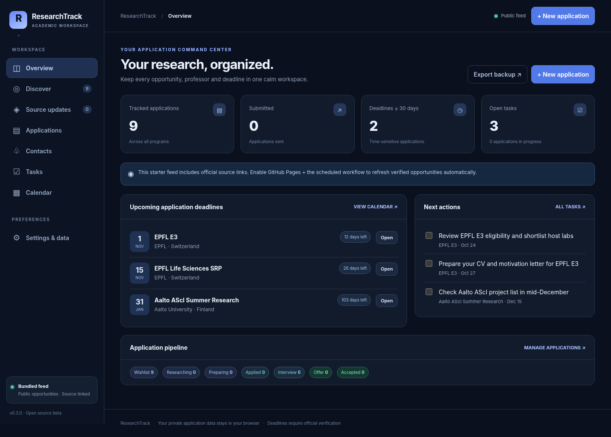

# ResearchTrack

ResearchTrack is a private, browser-based workspace for research internships and
academic applications. Version 0.5 runs locally with no build step, account, or
backend.



## What it does

- Tracks applications, contacts, tasks, deadlines, documents, funding, and notes.
- Includes a small, curated catalog of source-linked research opportunities.
- Exports application data as JSON, CSV, and calendar files.
- Matches pasted CV text to catalog entries with a transparent, rule-based scorer.
- Checks a limited set of official program pages through GitHub Actions.

The advisor is not an admission predictor and does not send email. Program details
and deadlines should always be confirmed on the linked official page. It ranks the
current catalog; it is not a search engine for every opportunity on the web.

## Run locally

Open `index.html` in a browser. For HTTP-based testing, run:

```bash
python3 -m http.server 8000
```

Then open `http://localhost:8000`.

Workspace data stays in browser `localStorage`. CV text used by the advisor stays
in the current tab and is not included in exports. Back up your workspace before
clearing browser data or moving to another browser or device.

## Tests

The parser and advisor tests require only Python 3 and Node.js:

```bash
python3 -m unittest discover -s tests -v
node tests/advisor.test.js
```

The optional UI smoke test requires Playwright and Chromium:

```bash
python3 tests/ui_smoke.py
```

To inspect source updates without changing tracked files:

```bash
python3 scripts/update_opportunities.py --dry-run
```

The updater only changes public catalog files after a source-specific parser
confirms the expected application cycle. Fetch or parse failures keep the last
verified data.

## Deployment

The workflow in `.github/workflows/site.yml` runs tests, refreshes monitored public
data on schedule, and deploys the static site to GitHub Pages. Private browser data
is never available to the workflow or committed to the repository.

See [CONTRIBUTING.md](CONTRIBUTING.md) for contribution notes and
[SECURITY.md](SECURITY.md) for reporting security issues.

## License

[MIT](LICENSE)
