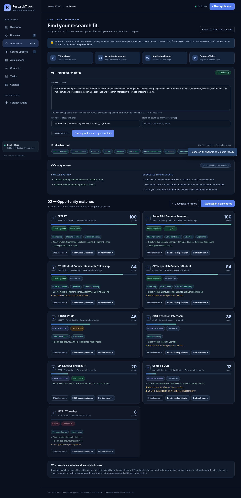

# ResearchTrack

**A free, open-source workspace for research internships and academic applications.**

Track opportunities, universities, labs, professors, emails, document checklists,
deadlines, outreach and applications — without giving your private data to a third party.


## Features today (v0.4)



- **Advisor Lab (v0.4, offline prototype):** paste CV text or upload a `.txt`/`.md` resume, optionally enter research interests and preferred countries, receive explainable research-alignment scores, see deadline/eligibility cautions, export a Markdown fit report, add suggested tasks, and draft editable supervisor outreach emails. The engine is **rule-based, not an LLM**, and **scores do not represent admission probabilities**. PDF/DOCX extraction and true AI-agent workflows are planned but not implemented.
- **Overview:** tracked programs, submission counts, urgent deadlines and pending tasks.
- **Discover:** nine starter opportunities with official source links and confidence labels.
- **Applications:** configurable application types (research internships, RA, PhD, master’s, fellowships and summer schools), statuses, priorities, countries, labs, PIs, contact emails, submitted dates,
  document checklist, funding, visa and private notes.
- **Contacts:** multiple research contacts, lab websites, ranked supervisor preferences, outreach stages and follow-up dates.
- **Tasks:** checklists, due dates, and program links.
- **Calendar:** applications and tasks, plus an `.ics` export for any calendar app.
- **Export:** JSON backup/restore and CSV application export.
- **Privacy:** personal data only in local browser storage, not on the GitHub Pages server.
- **Source updates:** public change history and private deadline-change alerts for tracked programs.
- **Source checks:** optional twice-daily GitHub Actions public feed updater for three
  official 2027 deadline pages and the paused ISTA cycle. Parsing failures retain old dates.

The official sources preloaded in the catalog should always be reconfirmed before applying.
**No email is sent automatically, no professor address is fabricated, and there is no live
account sync yet.** The public monitor is not a guarantee that every website change is caught.

## Run locally

Unzip the repository and open **`index.html`** in a browser. No npm, build process,
external CDN, or server is required for local use.

To also test public-feed network polling with a development server:

```bash
python3 -m http.server 8000
# Open http://localhost:8000
```

Your app data is stored under `researchtrack-workspace-v2` in `localStorage`. **CV text entered into the Advisor stays in the current browser tab and is not stored in localStorage or exported.** Export a JSON
backup periodically, especially before clearing browser data or switching devices.

## Live public opportunity updates

There are **two completely separate data layers**:

| Layer | Where it lives | Contents |
| --- | --- | --- |
| Public opportunity feed | `data/opportunities.json`, maintained in Git | Programs, public links, source checks, deadlines |
| Private workspace | Browser `localStorage` | Applications, supervisors, personal emails, tasks, notes |

After GitHub Pages deployment, the browser checks the public feed every **15 minutes while
open**. GitHub Actions tries to verify official sources **twice daily**. The feed only marks a
deadline *verified* if a narrow source-specific parser confirms it for the expected cycle.
This is scheduled checking, **not instantaneous real-time streaming**.

Run parser tests:

```bash
python3 -m unittest discover -s tests -v
```

Optional browser interaction smoke test (requires Playwright and Chromium):

```bash
python3 tests/ui_smoke.py
```

Run a one-time source check (requires network access):

```bash
python3 scripts/update_opportunities.py
```

When a fetch or parser fails, it preserves the previously recorded verified date, logs
what was skipped, and does not claim that source was freshly checked. More programs can
be added to `scripts/update_opportunities.py` with appropriate tests.

## Publish on GitHub Pages

1. Create a new public repository, e.g. `researchtrack`.
2. Push these project files to the repository's `main` branch.
3. Go to **Settings → Pages → Build and deployment → GitHub Actions**.
4. In **Actions**, enable workflows if GitHub asks.
5. Run `Check opportunities and deploy` manually once, or push to `main`.
6. The site URL appears in the workflow and the repository's Pages settings.

The workflow uses GitHub Actions with the repository token to commit **public feed metadata
only**. On a repository with restricted workflow permissions, you may need to allow write
access for workflow contents in Actions settings. It does **not** commit users' local data.

## Contributing

See [the roadmap](docs/ROADMAP.md), [contributing guide](CONTRIBUTING.md), and [security notes](SECURITY.md). Suggestions and PRs for trustworthy source monitors,
new application types, accessible UI and optional private sync are welcome.

Never submit actual applicant emails, CVs, private outreach notes or personal backups to a
public repository. Source changes should cite official sites and respect their access rules.

## Using the Advisor Lab

1. Open **AI Advisor** in the sidebar.
2. Paste CV text (or upload `.txt` / `.md`) and optionally enter research interests and countries.
3. Select **Analyze & match opportunities**. Review the score explanations and cautions.
4. Choose **Download fit report**, **Add action plan to tasks**, or **Draft outreach** for any specific program.
5. Confirm program requirements and revise every generated draft before using it. No email is sent by ResearchTrack.

**Important:** This is a transparent, deterministic prototype for exploring fit. The current nine-program feed is not an exhaustive directory. It does not read papers, independently validate degrees or visas, access the user's calendar, or estimate chances of admission. CVs remain in session memory only. Browser reload clears them. For PDF/DOCX, paste selectable text for now. For a future AI-enabled backend, consent and private processing boundaries must be implemented first. See [Advisor architecture](docs/ADVISOR_ARCHITECTURE.md).

Run matching tests:

```bash
node tests/advisor.test.js
```

## Limitations

- Starter opportunities focus on 2027, but date labels differ in certainty.
- Certain programs have paused cycles (ISTA ISTernship 2027).
- The automatic monitor covers only four official sources in v0.3; other records are static.
- No login, email sending, shared cloud database, live LLM service or direct Google Calendar write permission.
- No native PDF/DOCX CV ingestion yet; text import/paste works offline.
- `.ics` calendars are exports, not automatic Google Calendar synchronization.
- Browser data is per device/browser/origin. A file:// preview and a deployed URL have
  separate stores; use JSON backup/restore when migrating.

## License

[MIT](LICENSE)
